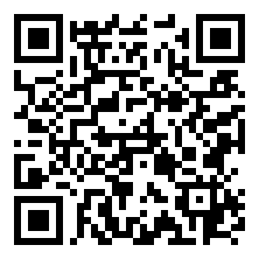

# Herramientas corporativas 26-27

## Presentación

El seminario de centro «Herramientas corporativas 26-27» está dirigido al profesorado del [Instituto de Educación Secundaria (IES) Macià Abela](https://portal.edu.gva.es/iesmaciaabela/). A lo largo de veinte horas se trabajan las herramientas corporativas de la Conselleria de Educación y la competencia digital docente (CDD): los servicios con los que el centro se comunica, organiza la docencia y custodia la información del alumnado.

!!! tip "Material de referencia del seminario"

    Este Sway de Conselleria recoge todas las plataformas que usa el profesorado, y cada sesión del seminario desarrolla una parte adaptada al centro.

    - :material-presentation-play: [Plataformes TIC per al personal docent](https://sway.office.com/BXHUfqCtnkWxgTnN)

El seminario forma parte de la coordinación de Tecnologías de la Información y la Comunicación (TIC) del centro. Dentro del programa, la sesión presencial IESMA TIC I trata IESMA TIC, la aplicación del propio centro, que reúne sus recursos y procedimientos TIC. El profesorado la consulta cuando necesita uno de esos recursos en el trabajo diario. La intención del seminario es que use con soltura la identidad digital y el resto de servicios corporativos.

<figure style="max-width: 220px; margin: 1.5em auto; text-align: center;">
  
  <figcaption style="margin-top: 0.6em;"><a href="https://fjavier-hernandez.github.io/iesmatic">Abrir IESMA TIC</a></figcaption>
</figure>

## Organización y calendario

El seminario son veinte sesiones. Nueve son presenciales y se cursan en el aula SMR2, de 14:00 a 15:00. Las otras once son de trabajo en casa. Entre una sesión presencial y la siguiente, ese trabajo sirve para repasar, para probar en la propia cuenta lo visto en el aula y para llegar con la práctica hecha.

Abrir un tique se hace en gvaSAI, la aplicación del Soporte y Asistencia Informática. La columna Material del calendario indica si los apuntes de esa sesión ya pueden consultarse.

| N.º | Fecha | Modalidad | Tema | Material |
| ---: | --- | --- | --- | --- |
| 1 | 5/11/26 | Presencial | [Presentación. Identidad digital: contraseña, recuperación, doble factor (MFA) y correo corporativo](sesiones/sesion-1.md) | Disponible |
| 2 | 12/11/26 | En casa | [ITACA3 más allá del módulo docente](sesiones/sesion-2.md) | Disponible |
| 3 | 19/11/26 | Presencial | IESMA TIC I: presentación, Incidencias TIC (y cuándo abrir un tique en gvaSAI) y REDAR. OneDrive | Próximamente |
| 4 | 3/12/26 | En casa | IESMA TIC II: VATERLOO y PARTENON | Próximamente |
| 5 | 10/12/26 | En casa | OneDrive y SharePoint: guardar y compartir | Próximamente |
| 6 | 17/12/26 | Presencial | Aules I: crear el aula y organizar el curso | Próximamente |
| 7 | 7/1/27 | En casa | Aules II: recursos e integración con OneDrive | Próximamente |
| 8 | 14/1/27 | Presencial | Aules III: tareas y entregas | Próximamente |
| 9 | 21/1/27 | En casa | Aules IV: cuestionarios | Próximamente |
| 10 | 4/2/27 | Presencial | Aules V: calificaciones y rúbricas | Próximamente |
| 11 | 11/2/27 | Presencial | Teams I: crear los equipos de clase desde ITACA | Próximamente |
| 12 | 18/2/27 | En casa | Teams II: publicaciones, chat y reuniones | Próximamente |
| 13 | 4/3/27 | Presencial | Teams III: Videoconferencias: reuniones en Teams paso a paso | Próximamente |
| 14 | 11/3/27 | En casa | Teams IV: Teams para la gestión del centro (Claustre, departamentos y calendarios compartidos) | Próximamente |
| 15 | 8/4/27 | Presencial | Accesibilidad: documentos y materiales inclusivos | Próximamente |
| 16 | 15/4/27 | En casa | Competencia digital del alumnado: seguridad y buen uso | Próximamente |
| 17 | 22/4/27 | En casa | Appsedu: apps autorizadas y protección de datos | Próximamente |
| 18 | 6/5/27 | En casa | OVIDOC y otras plataformas de Conselleria | Próximamente |
| 19 | 13/5/27 | En casa | Taller: preparar el producto final | Próximamente |
| 20 | 20/5/27 | Presencial | Puesta en común y cierre | Próximamente |

Si una sesión presencial no pudiera celebrarse, las fechas de reserva para recuperarla son el 3, el 10 y el 17 de junio de 2027.

## Metodología y forma de trabajo

En las sesiones presenciales se trabaja el tema con la cuenta corporativa abierta y se resuelven en directo las dudas de la tarea anterior. En las sesiones en casa, cada uno sigue los apuntes a su ritmo y hace una tarea breve que se entrega en el curso de Aules Docent del seminario. Las dudas se plantean en el foro del curso, para que todo el grupo pueda aprovechar las respuestas, o de forma privada en Dudas Individuales. La organización de cada sesión puede ajustarse según cómo avance el grupo.

## Evaluación y asistencia

Para completar el seminario se necesita un 85 % de asistencia. La asistencia se registra firmando el acta de cada sesión presencial. Esa firma es el registro que se conserva, así que conviene firmar durante la propia sesión.

Ese porcentaje se refiere a las sesiones presenciales, que son las que quedan recogidas en el acta. El trabajo de casa se entrega en el curso de Aules Docent del seminario.
