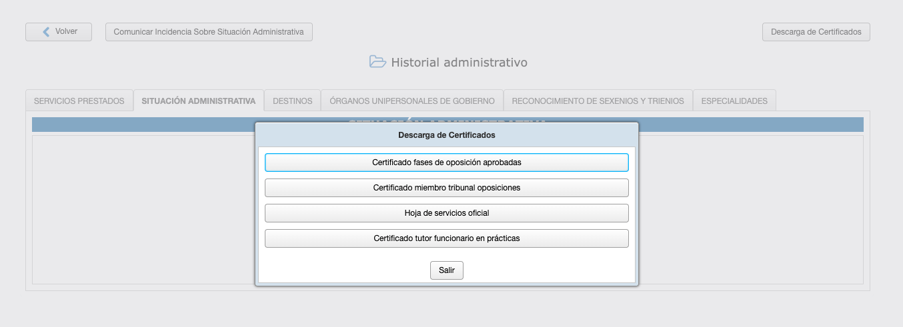

# Sesión 2. ITACA3 más allá del módulo docente

ITACA3 es el sistema con el que el centro gestiona la información académica, el funcionamiento cotidiano y los trámites del personal docente. El escritorio abre un panel con tres bloques: gestión de centro, gestión docente y trámites y servicios. En trámites y servicios están OVIDOC, la oficina del expediente y de la hoja de servicios, y OVIFOR, la oficina de la formación permanente. Saber qué hay en cada bloque permite ir directo al dato, al horario o a la inscripción que hace falta ese día.

!!! info "Punto de partida de la sesión"

    El escritorio de ITACA3 reúne los accesos de gestión de centro, gestión docente y trámites y servicios. El portal y los manuales de ITACA describen el sistema, y el Sway Plataformes TIC per al personal docent recorre las plataformas del profesorado.

    - :material-monitor: [Acceso directo a ITACA3](https://itaca3.edu.gva.es/escriptori/)
    - :material-book-open-page-variant: [Portal de ITACA](https://portal.edu.gva.es/itaca/es/)
    - :material-book-open-page-variant: [Manuales de ITACA](https://portal.edu.gva.es/itaca/es/manuales_itaca/)
    - :material-presentation-play: [Plataformes TIC per al personal docent](https://sway.office.com/BXHUfqCtnkWxgTnN)

<figure markdown="span">
  
  <figcaption>Panel de inicio de ITACA3</figcaption>
</figure>

## Gestión de centro

La gestión de centro agrupa la gestión académica, la administrativa y la económica. Con estos módulos trabajan la secretaría y el equipo directivo, porque reúnen la información del alumnado, el funcionamiento del centro y su actividad económica. No sustituyen a la pantalla con la que el profesorado pasa lista o pone calificaciones.

### GAC

!!! abstract "En este apartado"

    - La gestión académica (GAC) concentra la información académica del alumnado: la matrícula, la evaluación, la admisión, los certificados y el seguimiento.
    - Las actividades complementarias y extraescolares se revisan en este módulo, y solo pasan a OVIDOC cuando están en estado «Aprob. Memoria».

    - :material-book-open-page-variant: [Índice del módulo de gestión académica](https://ceice.gva.es/webitaca/docs/Manuales_ITACA3/Manuals_ITACA3-GAC.pdf)

??? note "Leer más"

    El portal de ITACA describe la gestión académica como el conjunto de la información académica del alumnado. Entran ahí la matrícula, la evaluación, la admisión, los certificados y el seguimiento académico. Es trabajo de secretaría y del equipo directivo, y el índice del módulo reúne las guías de esas pantallas.

    Las actividades complementarias y extraescolares se revisan en GAC. Solo cuando quedan en estado «Aprob. Memoria» pasan al apartado de formación de OVIDOC, en la sincronización nocturna. Si falta una actividad, hay que pedir a la dirección del centro en el que se hizo que revise ese estado.

### GAD

!!! abstract "En este apartado"

    - La gestión administrativa (GAD) organiza el funcionamiento del centro: el personal, las aulas, los horarios, los servicios, las becas, las comunicaciones y la gestión cotidiana.
    - La edición de horarios por docente y por grupo, y el calendario de festivos del centro, son gestión administrativa, distinta del horario de clase del módulo docente.
    - El Programa de Actividades Formativas (PAF) es la formación de centro que se tramita en ITACA3. La dirección graba a la coordinación, la secretaría valida y la dirección presenta.

    - :material-book-open-page-variant: [Índice del módulo de gestión administrativa](https://ceice.gva.es/webitaca/docs/Manuales_ITACA3/Manuals_ITACA3-GAD.pdf)
    - :material-book-open-page-variant: [Manual de horarios de ITACA3-GAD](https://ceice.gva.es/webitaca/docs/Manuales_ITACA3/Gestion_Administrativa/Manual_Edicion_Horarios_ITACA3-GAD_cas.pdf)
    - :material-book-open-page-variant: [Manual del calendario del centro](https://ceice.gva.es/webitaca/docs/Manuales_ITACA3/Gestion_Administrativa/Manual_Calendario_Centro_ITACA3.pdf)
    - :material-book-open-page-variant: [Manual de personal de ITACA3-GAD](https://ceice.gva.es/webitaca/docs/Manuales_ITACA3/Gestion_Administrativa/Manual_Personal_ITACA3-GAD_cas.pdf)
    - :material-book-open-page-variant: [Programa anual de formación](https://ceice.gva.es/es/web/formacion-profesorado/formacio/programa-anual-de-formacio)
    - :material-book-open-page-variant: [Manual de la fase de desarrollo del PAF 2024-2025](https://ceice.gva.es/documents/162880217/389062473/50.+Manual+FASE+II+PAF_CAF_cas+Nuevo+Dise%C3%B1o.pdf/da107ab2-8f5b-b95e-d3e8-642aba4d5e90)

??? note "Leer más"

    El horario como documento de gestión del centro se edita en GAD, por docente y por grupo, con plantillas y con la importación y la exportación que publica el índice del módulo. Esa edición no es la consulta del horario de clase, que está en el módulo docente. Desde la vista de clase no corresponde crear ni importar plantillas.

    El calendario del centro también está en la gestión administrativa. Refleja los festivos introducidos por ordenación académica o por personal, y el centro puede añadir los festivos locales. La guía detalla el alta y la baja de esos días para quien tiene esa gestión. Ese calendario no sustituye al horario de sesiones del módulo docente, y la familia consulta los horarios semanales de las clases en la Web Familia.

    El manual de personal indica que los datos identificativos vienen del registro de personal y que en la ficha tienen carácter informativo. El listado de personal del centro muestra la ficha de otras personas. La consulta que cada docente hace de sus propios datos está en OVIDOC, no en ese listado.

    El PAF es el programa anual de formación permanente de centro. Para el curso 2026-2027, la dirección graba a la persona coordinadora de formación, esa coordinación y quienes coordinan cada actividad preparan el programa, la secretaría valida y la dirección presenta. El circuito del centro está en la página de ese curso.

    Quien participa en una actividad recibe un aviso en el correo de su perfil de ITACA para entrar en OVIDOC y aceptar o rechazar la participación. Si el aviso no llega, el manual de la fase de desarrollo 2024-2025, dirigido a la coordinación de la actividad, indica entrar directamente en OVIDOC.

### GEC

!!! abstract "En este apartado"

    - La gestión económica (GEC) administra la actividad económica del centro: la contabilidad, las tasas, la facturación y el control de recursos.
    - La usan la secretaría y el equipo directivo. No hace falta abrirla para pasar lista, poner calificaciones o consultar el expediente propio.

    - :material-book-open-page-variant: [Índice del módulo de gestión económica](https://ceice.gva.es/webitaca/docs/Manuales_ITACA3/Manuals_ITACA3-GEC.pdf)

??? note "Leer más"

    El portal de ITACA resume la gestión económica en la contabilidad, las tasas, la facturación y el control de recursos. El índice del módulo reúne las guías de esas pantallas. Quien no lleva la economía del centro resuelve su trabajo docente en el módulo docente y sus datos propios en OVIDOC.

## Gestión docente

La gestión docente agrupa el aula virtual, las tareas de la clase y el seguimiento de la formación en empresa. Desde este bloque se abre Aules, el módulo docente y SAÓ Gestión.

### Aules

!!! abstract "En este apartado"

    - Aules es el aula virtual de la Conselleria.
    - El profesorado la usa para las aulas virtuales del centro.

    - :material-book-open-page-variant: [Aules](https://portal.edu.gva.es/aules/)

??? note "Leer más"

    Aules es la plataforma educativa en línea de la Conselleria. El profesorado entra en ella para las aulas virtuales del centro. El portal de Aules explica cómo se accede a la plataforma y cómo se organizan esas aulas.

### Módulo docente

!!! abstract "En este apartado"

    - El módulo docente reúne las tareas del personal docente: calificaciones, faltas y comunicaciones.
    - El horario de sesiones con el que se trabaja la clase está dentro de este módulo, junto con la información del centro y el dietario.
    - La Web Familia muestra a las familias las calificaciones, las faltas, el calendario de evaluaciones, las actividades, los horarios semanales y las comunicaciones del docente y del centro.
    - Consultar el horario no exige modificar faltas ni calificaciones.

    - :material-book-open-page-variant: [Página del módulo docente](https://portal.edu.gva.es/itaca/es/modulo-docente/)
    - :material-book-open-page-variant: [Manual del módulo docente](https://ceice.gva.es/webitaca/docs/moduls/modul_docent2.pdf)
    - :material-book-open-page-variant: [Qué es ITACA y la Web Familia 2.0](https://portal.edu.gva.es/itaca/es/que-es-itaca-y-la-web-familia-2-0/)
    - :material-presentation-play: [Videotutorial del módulo docente](https://sway.cloud.microsoft/LXE0MZbs0tYQDV5m?ref=Link&loc=play)

??? note "Leer más"

    El portal define el módulo docente como el espacio para pasar lista, poner notas y conectar con ITACA y con la Web Familia, desde el ordenador o desde otro dispositivo con conexión, sin instalar una aplicación. ITACA, Innovación Tecnológica Administrativa de Centros y Alumnado, es la plataforma modular de información centralizada que conecta al sistema educativo valenciano. Este módulo es la vista de la clase dentro de esa plataforma.

    Quien busca su horario de clase lo encuentra en el manual del módulo, en el apartado de horario de sesiones, junto con la información del centro, las calificaciones y el dietario. Es la vista con la que se trabaja la clase del día. Lo que se graba aquí es lo que después ve la familia en la Web Familia.

    La Web Familia no es un bloque de trabajo del profesorado. Es la web en la que las familias consultan calificaciones, faltas, calendario de evaluaciones, actividades y horarios semanales, además de las comunicaciones del docente y del centro. Los datos personales y profesionales del docente no están en esta vista: se consultan en OVIDOC, la Oficina Virtual del Docente.

### SAÓ Gestión

!!! abstract "En este apartado"

    - SAÓ Gestión es el sistema de administración en línea para las formaciones en empresas.
    - Lo usa el profesorado tutor de la formación en empresa y quien coordina esa formación.
    - El acceso de ese profesorado se hace a través de ITACA.

    - :material-book-open-page-variant: [SAÓ Gestión](https://ceice.gva.es/es/web/formacion-profesional/formacio-en-empresa-fct-i-dual/sao-gestio)

??? note "Leer más"

    La página de Formación Profesional identifica el acceso del profesorado con el tutor y con quien coordina la formación en empresa, y lo distingue del acceso de la empresa y del alumnado. El del profesorado se realiza a través de ITACA.

## Trámites y servicios

Trámites y servicios agrupa las oficinas del expediente docente, de la formación permanente y de otros servicios del panel. OVIDOC y OVIFOR son las que el profesorado usa para sus datos y para la oferta de formación de la Conselleria.

### OVICE

!!! abstract "En este apartado"

    - OVICE es el acceso que el panel de inicio muestra en trámites y servicios con el nombre OVICE.

??? note "Leer más"

    OVICE comparte el bloque de trámites y servicios con otras oficinas, y no es la consulta del expediente propio ni la de la formación permanente. El expediente se consulta en OVIDOC y la inscripción en la formación de la Conselleria se consulta en OVIFOR.

### OVIDOC

!!! abstract "En este apartado"

    - OVIDOC, la Oficina Virtual del Docente, es el acceso preferente al expediente docente electrónico normalizado (EDEN). Los datos personales y profesionales del docente se consultan aquí.
    - El menú reúne información general, datos personales, historial administrativo, historial académico, formación, retribuciones y trámites, y puede variar según la relación con la Administración.
    - En datos personales se consultan los datos propios, se pueden editar los de contacto y se consulta la identidad digital, que también puede comprobarse desde el escritorio de ITACA3.
    - La formación de OVIDOC reúne la oferta de cursos y el historial formativo reconocido. Los sexenios y trienios ya reconocidos se consultan en el historial administrativo.
    - Los datos que muestra la oficina son del propio docente y no se copian fuera de ella.

    - :material-monitor: [Acceso a OVIDOC](https://ovidoc.edu.gva.es/)
    - :material-book-open-page-variant: [Portal de OVIDOC](https://portal.edu.gva.es/ovidoc/es/)
    - :material-book-open-page-variant: [Menú principal de OVIDOC](https://portal.edu.gva.es/ovidoc/es/2025/12/10/2-conoce-el-menu-principal-de-ovidoc/)
    - :material-book-open-page-variant: [Consulta y gestión de los datos personales](https://portal.edu.gva.es/ovidoc/es/2025/12/10/3-como-consultar-y-gestionar-mis-datos-personales/)
    - :material-book-open-page-variant: [Cómo consultar el historial administrativo](https://portal.edu.gva.es/ovidoc/es/2025/12/10/4-como-consultar-mi-historial-administrativo/)
    - :material-book-open-page-variant: [Cómo obtener la hoja de servicios oficial](https://portal.edu.gva.es/ovidoc/es/2025/12/10/como-puedo-obtener-una-hoja-de-servicios-prestados-oficial-por-ovidoc/)
    - :material-book-open-page-variant: [Cómo consultar la formación en OVIDOC](https://portal.edu.gva.es/ovidoc/es/2025/12/10/6-como-consultar-tu-formacion/)
    - :material-book-open-page-variant: [Cómo acceder a la identidad digital](https://portal.edu.gva.es/identitatdigital/es/com-puc-accedir-a-la-meua-identitat-digital-es/)
    - :material-book-open-page-variant: [Orden 5/2021, sobre EDEN y OVIDOC](https://dogv.gva.es/datos/2021/02/17/pdf/2021_1347.pdf)

??? note "Leer más"

    La Orden 5/2021, de 12 de febrero (DOGV núm. 9022, de 17 de febrero de 2021), regula el contenido, el uso y el acceso al expediente docente electrónico normalizado (EDEN). Su artículo 1 establece que OVIDOC es la plataforma de acceso preferente a ese expediente y a los trámites del ámbito de la orden. El artículo 3 define el expediente como el sistema que reúne los datos personales y administrativos del personal docente incluido en su ámbito, y el artículo 4 precisa que a cada persona le corresponde el suyo. La oficina se abre con la propia identidad digital y conviene consultar solo los datos propios.

    El menú principal avisa de que los iconos dependen de la relación contractual, así que dos personas pueden no ver la misma pantalla. El historial administrativo incluye servicios, destinos, situación administrativa, órganos unipersonales y el reconocimiento de sexenios y trienios. El académico incluye capacitaciones, idiomas, títulos y otros datos del expediente.

    Si es personal público, dentro del historial administrativo el botón «Descarga de Certificados» permite generar el certificado de «Hoja de servicios oficial». La guía indica que esa descarga no está disponible todavía para todos los colectivos.

    Desde datos personales se consultan los datos y se editan los de contacto, para que la Administración disponga de un domicilio y de un teléfono actualizados. Si un dato de contacto propio está desactualizado, la guía pide corregirlo en la oficina, y esa corrección permanece allí. También se consulta y se gestiona la identidad digital, la cuenta de correo @edu.gva.es. La misma guía documenta la descarga del carnet docente para el personal público que cumple las condiciones que allí se indican. Quien sea docente de un centro concertado consulta con el equipo directivo algunos de esos datos, como la propia guía señala.

    El profesorado puede comprobar la identidad digital desde el escritorio de ITACA3 y desde OVIDOC. La identidad del alumnado se consulta en el módulo docente. Las retribuciones aparecen en el menú de OVIDOC como consulta de la propia nómina y de los certificados que la guía enumera, y no se copian fuera de la oficina.

    La guía de formación separa la oferta de cursos y el historial formativo. La oferta enlaza la formación gratuita de los centros de formación, innovación y recursos educativos (CEFIRE) y de las universidades de la Comunitat Valenciana. El historial incluye la certificación en PDF de la formación reconocida, las actividades que no computan para el sexenio y los créditos del sexenio en curso. El reconocimiento de sexenios y trienios se refleja cuando se hace el volcado mensual, y los ya reconocidos se consultan en el historial administrativo.

    Las actividades complementarias grabadas en GAC en estado «Aprob. Memoria» se sincronizan con OVIDOC cada noche, de modo que se ven en la oficina al día siguiente. Si falta una actividad, la guía pide hablar con la dirección del centro en el que se hizo, para que revise el estado, y no usar el botón de incidencia de OVIDOC para pedir un registro que corresponde a otro trámite. La inscripción en la formación permanente convocada por la Conselleria no se hace en este historial: se consulta y se solicita en OVIFOR.

### SID

!!! abstract "En este apartado"

    - SID reúne los servicios para el docente.

??? note "Leer más"

    SID presta servicios para el docente y no sustituye al expediente de OVIDOC ni a la clase del módulo docente. El expediente propio se consulta en OVIDOC, y las calificaciones, las faltas y las comunicaciones se trabajan en el módulo docente.

### OVIFOR

!!! abstract "En este apartado"

    - OVIFOR es la Oficina Virtual para la Formación. En ella se consulta y se solicita la inscripción en las actividades de formación permanente convocadas por la Conselleria.
    - El acceso se hace desde la propia oficina, con los sistemas de identificación de ITACA. El personal docente de centros públicos y concertados ya dispone de usuario.
    - Esta consulta es distinta del historial formativo que se mira en OVIDOC.

    - :material-monitor: [Acceso a OVIFOR](https://ovifor.edu.gva.es/)
    - :material-book-open-page-variant: [Oferta formativa del profesorado](https://ceice.gva.es/es/web/formacion-profesorado/formacio/oferta-formativa)
    - :material-book-open-page-variant: [Resolución de 20 de marzo de 2025, de acceso a OVIFOR](https://ceice.gva.es/documents/162880217/399333501/Resolucion_20032025_Acceso_OVIFOR_es.pdf/e6cae7c0-2d32-df19-cac5-a690d9c180fe)

??? note "Leer más"

    La Resolución de 20 de marzo de 2025, de la Secretaría Autonómica de Educación, regula el acceso a la Oficina Virtual de Formación (OVIFOR) para la inscripción en las actividades de formación permanente convocadas por la Conselleria. El acceso se realiza desde la dirección de la oficina, con los sistemas de identificación previstos para ITACA. De forma alternativa, la resolución admite los certificados electrónicos de la sede de la Generalitat y Cl@ve permanente. El personal docente y el personal de apoyo educativo de centros públicos y concertados ya dispone de usuario y no tiene que pedir el alta.

    La guía de formación de OVIDOC separa esa inscripción del historial que se consulta en la propia oficina, y la página de oferta formativa confirma que el procedimiento de solicitud de cursos pasa por OVIFOR. Una vez dentro, se localiza en la oferta una actividad de formación permanente con la inscripción abierta. No hace falta completar la inscripción para comprobar que la actividad está abierta.

## Tarea de casa

!!! abstract "En este apartado"

    - En OVIDOC se abre el historial administrativo, se pulsa «Descarga de Certificados» y se descarga la «Hoja de servicios oficial».
    - En OVIFOR se localiza una actividad formativa abierta que interese. No hace falta completar la inscripción.
    - La entrega, en el curso de Aules Docent del seminario, es un texto breve con el nombre de esa actividad y una frase que confirme la descarga.
    - No se sube el PDF de la hoja de servicios, porque contiene datos personales. Si no aparece en el perfil, se indica en la entrega.

??? note "Leer más"

    1. Entra en OVIDOC con la identidad digital.
    2. Abre «Historial administrativo».
    3. Pulsa «Descarga de Certificados».
    4. Descarga la «Hoja de servicios oficial». Si ese certificado no aparece en tu perfil, no elijas otro e indícalo en la entrega.

    <figure markdown="span">
      
      <figcaption>La captura corresponde a la vista de un funcionario de carrera. Al profesorado interino le pueden aparecer otras opciones o menos botones, y en esta tarea solo se descarga la hoja de servicios.</figcaption>
    </figure>

    5. Entra en OVIFOR y localiza una actividad formativa abierta que te interese.
    6. En el curso de Aules Docent del seminario, entrega un texto breve con el nombre de esa actividad y una frase que confirme que has descargado la hoja de servicios. No subas el PDF, porque contiene datos personales. Si la hoja no aparece en tu perfil, dilo en ese texto.

    !!! warning "Qué no debe contener la entrega"

        El texto de la entrega no incluye nombres de alumnado ni de otras personas, DNI, NIA, domicilio, teléfono, correo personal, nómina ni capturas en las que se lean esos datos. Tampoco se adjunta la hoja de servicios, porque el PDF contiene datos personales. Si la hoja no aparece en el perfil, la entrega lo indica y no se sustituye por otro certificado.

## Referencias

!!! abstract "En este apartado"

    - La Orden 5/2021 fija qué es OVIDOC, a quién corresponde el expediente y con qué sistemas de identificación se accede.
    - Los manuales de GAC, GAD y GEC se sustituyen cuando la Conselleria publica una guía nueva, y en la pantalla del centro manda la guía vigente.
    - Un manual de gestión del centro describe esa gestión, y la consulta personal del docente se hace en OVIDOC.

??? note "Leer más"

    El artículo 7 de la Orden 5/2021 remite el acceso al expediente a los sistemas de identificación previstos para la comunicación de datos a través de ITACA, y admite también los certificados de la sede electrónica de la Generalitat y Cl@ve permanente. Conviene usar OVIDOC para los datos propios y el manual del módulo que corresponda para cada gestión del centro.

    Los índices de gestión académica, administrativa y económica cambian cuando la Conselleria publica una guía nueva. Si una pantalla del centro no coincide con la guía que se tenía a mano, manda el manual vigente de ese módulo.
