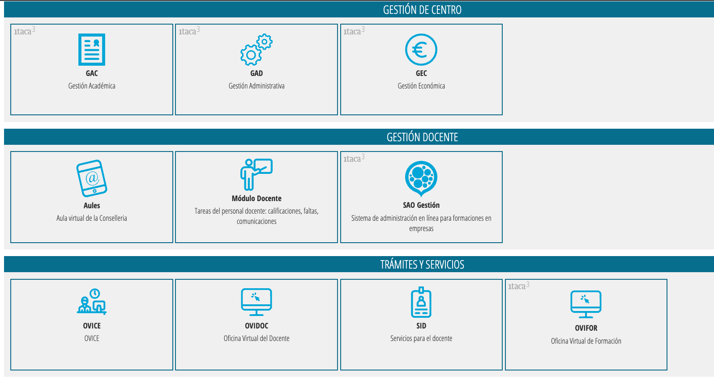

# Sesión 2. ITACA3 más allá del módulo docente

El módulo docente de ITACA3 cubre la docencia inmediata, sobre todo la asistencia y las calificaciones. La plataforma incluye, además, los módulos de gestión del centro. Los datos personales y profesionales del docente se consultan en OVIDOC, la Oficina Virtual del Docente. Distinguir el bloque que corresponde a cada tarea evita abrir un módulo que no la resuelve.

!!! info "Punto de partida de la sesión"

    El escritorio de ITACA3 reúne los accesos a los módulos. El portal de ITACA, sus manuales y la definición del proyecto concretan qué hace cada bloque de gestión, y el portal de OVIDOC concreta la consulta personal. El Sway de plataformas TIC sitúa ese conjunto entre las herramientas del personal docente.

    - :material-monitor: [Acceso directo a ITACA3](https://itaca3.edu.gva.es/escriptori/)
    - :material-book-open-page-variant: [Portal de ITACA](https://portal.edu.gva.es/itaca/es/)
    - :material-book-open-page-variant: [Manuales de ITACA](https://portal.edu.gva.es/itaca/es/manuales_itaca/)
    - :material-book-open-page-variant: [Qué es ITACA y la Web Familia 2.0](https://portal.edu.gva.es/itaca/es/que-es-itaca-y-la-web-familia-2-0/)
    - :material-book-open-page-variant: [Portal de OVIDOC](https://portal.edu.gva.es/ovidoc/es/)
    - :material-presentation-play: [Plataformes TIC per al personal docent](https://sway.office.com/BXHUfqCtnkWxgTnN)

## El panel de ITACA3

<figure markdown="span">
  
  <figcaption>Panel de ITACA3. Los tres bloques y los rótulos de cada icono son los que usa el apartado.</figcaption>
</figure>

!!! abstract "En este apartado"

    - El panel de ITACA3 agrupa los accesos en tres bloques: gestión de centro, gestión docente, y trámites y servicios.
    - Gestión de centro reúne la gestión académica (GAC), la gestión administrativa (GAD) y la gestión económica (GEC), y es el bloque que usan la secretaría y el equipo directivo.
    - En el [portal de ITACA](https://portal.edu.gva.es/itaca/es/), GAC concentra la información académica del alumnado, GAD organiza el funcionamiento del centro y GEC administra su actividad económica.
    - Aules es el aula virtual de la Conselleria.
    - El módulo docente reúne las tareas del personal docente: calificaciones, faltas y comunicaciones.
    - SAÓ Gestión es el sistema de administración en línea para las formaciones en empresas.
    - OVICE aparece en el panel solo con su sigla, sin una descripción de la función.
    - OVIDOC es la Oficina Virtual del Docente.
    - SID aparece en el panel como servicios para el docente.
    - OVIFOR es la Oficina Virtual de Formación.

    El escritorio y las fichas que describen estos accesos son los siguientes.

    - :material-monitor: [Acceso directo a ITACA3](https://itaca3.edu.gva.es/escriptori/)
    - :material-book-open-page-variant: [Portal de ITACA](https://portal.edu.gva.es/itaca/es/)
    - :material-book-open-page-variant: [Aules](https://portal.edu.gva.es/aules/)
    - :material-book-open-page-variant: [Módulo docente](https://portal.edu.gva.es/itaca/es/modulo-docente/)
    - :material-book-open-page-variant: [SAÓ Gestión](https://ceice.gva.es/es/web/formacion-profesional/formacio-en-empresa-fct-i-dual/sao-gestio)
    - :material-book-open-page-variant: [Portal de OVIDOC](https://portal.edu.gva.es/ovidoc/es/)
    - :material-book-open-page-variant: [Acceso a OVIFOR](https://ovifor.edu.gva.es/)

??? note "Leer más"

    El [portal de ITACA](https://portal.edu.gva.es/itaca/es/) presenta la plataforma como el sistema modular de información centralizada que conecta al sistema educativo valenciano, y desarrolla la sigla como Innovación Tecnológica Administrativa de Centros y Alumnado. En gestión de centro, la gestión académica abarca la matrícula, la evaluación, la admisión, los certificados y el seguimiento del alumnado. La gestión administrativa abarca el personal, las aulas, los horarios, los servicios, las becas, las comunicaciones y la gestión cotidiana.

    La gestión económica abarca la contabilidad, las tasas, la facturación y el control de recursos. Esas tres piezas las trabajan la secretaría y el equipo directivo, y no sustituyen a la pantalla con la que el profesorado pasa lista o pone calificaciones.

    [Aules](https://portal.edu.gva.es/aules/) es el aula virtual que el panel nombra así, y el [módulo docente](https://portal.edu.gva.es/itaca/es/modulo-docente/) es la vista de calificaciones, faltas y comunicaciones. SAÓ Gestión, OVIDOC y OVIFOR tienen fuente propia y se explican en sus apartados. OVICE y SID se dejan en el rótulo del panel: OVICE solo con su sigla y SID como servicios para el docente.

## El sistema y sus tres módulos

!!! abstract "En este apartado"

    - ITACA es el sistema de información centralizado de la gestión educativa valenciana, y el portal lo presenta como la plataforma modular que conecta a todo el sistema educativo.
    - La gestión del centro se organiza en tres módulos: gestión académica, gestión administrativa y gestión económica.
    - El módulo docente es la vista del trabajo de aula, con la asistencia, las calificaciones y la comunicación con las familias.
    - La Web Familia muestra a las familias lo que se graba en esa vista, y no es un bloque de trabajo del profesorado.

    Los materiales de este apartado son los siguientes.

    - :material-book-open-page-variant: [Portal de ITACA](https://portal.edu.gva.es/itaca/es/)
    - :material-book-open-page-variant: [Qué es ITACA y la Web Familia 2.0](https://portal.edu.gva.es/itaca/es/que-es-itaca-y-la-web-familia-2-0/)
    - :material-book-open-page-variant: [Manuales de ITACA](https://portal.edu.gva.es/itaca/es/manuales_itaca/)
    - :material-book-open-page-variant: [Índice del módulo de gestión académica](https://ceice.gva.es/webitaca/docs/Manuales_ITACA3/Manuals_ITACA3-GAC.pdf)
    - :material-book-open-page-variant: [Índice del módulo de gestión administrativa](https://ceice.gva.es/webitaca/docs/Manuales_ITACA3/Manuals_ITACA3-GAD.pdf)
    - :material-book-open-page-variant: [Índice del módulo de gestión económica](https://ceice.gva.es/webitaca/docs/Manuales_ITACA3/Manuals_ITACA3-GEC.pdf)
    - :material-book-open-page-variant: [Módulo docente](https://portal.edu.gva.es/itaca/es/modulo-docente/)
    - :material-presentation-play: [Plataformes TIC per al personal docent](https://sway.office.com/BXHUfqCtnkWxgTnN)

??? note "Leer más"

    ITACA desarrolla las siglas de Innovación Tecnológica Administrativa de Centros y Alumnado. El [portal de ITACA](https://portal.edu.gva.es/itaca/es/) lo presenta como la plataforma modular de información centralizada que conecta a todo el sistema educativo valenciano. La [página sobre ITACA y la Web Familia](https://portal.edu.gva.es/itaca/es/que-es-itaca-y-la-web-familia-2-0/) lo sitúa como el proyecto de la Conselleria para la gestión administrativa y académica de los centros de la Comunitat Valenciana.

    Ese portal describe los tres módulos de gestión del centro y publica las guías de GAC, GAD y GEC. El de gestión académica reúne la información académica del alumnado: matrícula, evaluación, admisión, certificados y seguimiento. El de gestión administrativa organiza el funcionamiento del centro, con el personal, las aulas, los horarios, los servicios, las becas y las comunicaciones. El de gestión económica administra la contabilidad, las tasas, la facturación y el control de recursos. Cada guía concreta está en el índice del módulo que le corresponde.

    El [módulo docente](https://portal.edu.gva.es/itaca/es/modulo-docente/) es la vista del día a día de la clase. El portal lo define como el espacio para pasar lista, poner notas y conectar con ITACA y con la Web Familia, desde el ordenador o desde otro dispositivo con conexión, sin instalar una aplicación. Su manual incluye el horario de sesiones dentro de esa misma vista, junto con la información del centro, las calificaciones y el dietario.

    La Web Familia no es un bloque del profesorado. La [página oficial](https://portal.edu.gva.es/itaca/es/que-es-itaca-y-la-web-familia-2-0/) la describe como la web en la que las familias consultan calificaciones, faltas, calendario de evaluaciones, actividades y horarios semanales, además de las comunicaciones del docente y del centro. Conviene tenerla presente porque lo que se graba en el módulo docente es lo que después ve la familia. Los datos personales y profesionales del docente no están en estos tres módulos: se consultan en OVIDOC, la Oficina Virtual del Docente.

## Datos personales y administrativos

!!! abstract "En este apartado"

    - La Oficina Virtual del Docente (OVIDOC) es el acceso preferente al expediente docente electrónico normalizado (EDEN).
    - El menú documentado reúne información general, datos personales, historial administrativo, historial académico, formación, retribuciones y trámites, y puede variar según la relación con la Administración.
    - En datos personales se consultan los datos propios, se pueden editar los de contacto y se consulta la identidad digital.
    - La identidad digital también se comprueba desde el escritorio de ITACA3, como ya permite la pregunta frecuente de Identitat Digital.
    - Los datos que muestra la oficina son del propio docente y no se copian fuera de ella.

    Los materiales de este apartado son los siguientes.

    - :material-book-open-page-variant: [Menú principal de OVIDOC](https://portal.edu.gva.es/ovidoc/es/2025/12/10/2-conoce-el-menu-principal-de-ovidoc/)
    - :material-book-open-page-variant: [Consulta y gestión de los datos personales](https://portal.edu.gva.es/ovidoc/es/2025/12/10/3-como-consultar-y-gestionar-mis-datos-personales/)
    - :material-book-open-page-variant: [Cómo acceder a la identidad digital](https://portal.edu.gva.es/identitatdigital/es/com-puc-accedir-a-la-meua-identitat-digital-es/)
    - :material-book-open-page-variant: [Orden 5/2021, sobre EDEN y OVIDOC](https://dogv.gva.es/datos/2021/02/17/pdf/2021_1347.pdf)
    - :material-monitor: [Acceso a OVIDOC](https://ovidoc.edu.gva.es/)
    - :material-book-open-page-variant: [Portal de OVIDOC](https://portal.edu.gva.es/ovidoc/es/)
    - :material-presentation-play: [Plataformes TIC per al personal docent](https://sway.office.com/BXHUfqCtnkWxgTnN)

La oficina se abre en [OVIDOC](https://ovidoc.edu.gva.es/). Conviene identificarse con la propia identidad digital y consultar solo los datos propios.

??? note "Leer más"

    La [Orden 5/2021, de 12 de febrero](https://dogv.gva.es/datos/2021/02/17/pdf/2021_1347.pdf) (DOGV núm. 9022, de 17 de febrero de 2021), regula el contenido, el uso y el acceso al expediente docente electrónico normalizado (EDEN). Su artículo 1 establece que OVIDOC es la plataforma de acceso preferente a ese expediente y a los trámites del ámbito de la orden. El artículo 3 define el expediente como el sistema que reúne los datos personales y administrativos del personal docente incluido en su ámbito, y el artículo 4 precisa que a cada persona le corresponde el suyo. La orden se aplica al personal docente dependiente de la Generalitat Valenciana.

    El [menú principal](https://portal.edu.gva.es/ovidoc/es/2025/12/10/2-conoce-el-menu-principal-de-ovidoc/) avisa de que los iconos dependen de la relación contractual, así que dos personas pueden no ver la misma pantalla. En la guía, los apartados documentados son la información general y las publicaciones oficiales, los datos personales, el historial administrativo, el historial académico, la formación, las retribuciones y los trámites. El historial administrativo incluye servicios, destinos, situación administrativa, órganos unipersonales y el reconocimiento de sexenios y trienios. El académico incluye capacitaciones, idiomas, títulos y otros datos del expediente.

    La [guía de datos personales](https://portal.edu.gva.es/ovidoc/es/2025/12/10/3-como-consultar-y-gestionar-mis-datos-personales/) explica que desde ese apartado se consultan los datos y se editan los de contacto, para que la Administración disponga de un domicilio y de un teléfono actualizados. Si un dato de contacto propio está desactualizado, la guía pide corregirlo en la oficina, y esa corrección permanece allí. También se consulta y se gestiona la identidad digital, la cuenta de correo @edu.gva.es. La misma guía documenta la descarga del carnet docente para el personal público que cumple las condiciones que allí se indican, entre ellas disponer de fotografía y ocupar un puesto en la forma que el texto detalla. Quien sea docente de un centro concertado consulta con el equipo directivo algunos de esos datos, como la propia guía señala.

    La pregunta frecuente [«¿Cómo puedo acceder a mi identidad digital?»](https://portal.edu.gva.es/identitatdigital/es/com-puc-accedir-a-la-meua-identitat-digital-es/) dice que el profesorado puede comprobarla desde el escritorio de ITACA3 y desde OVIDOC, y que la identidad del alumnado se consulta en el módulo docente. Esa pregunta frecuente no publica una ruta de menús del escritorio. El manual de personal del módulo administrativo describe la ficha de personal del centro, no la consulta que cada docente hace de sí mismo.

    En los centros públicos, ese [manual de personal](https://ceice.gva.es/webitaca/docs/Manuales_ITACA3/Gestion_Administrativa/Manual_Personal_ITACA3-GAD_cas.pdf) indica que los datos identificativos vienen del registro de personal y que en la ficha tienen carácter informativo. El listado de personal del centro muestra la ficha de otras personas y no es la consulta que cada docente hace de sus propios datos. Las retribuciones aparecen en el menú de OVIDOC como consulta de la propia nómina y de los certificados que la guía enumera, y no se copian fuera de la oficina.

## Horario y calendario del centro

!!! abstract "En este apartado"

    - El horario de sesiones con el que el profesorado trabaja la clase está dentro del módulo docente, no en un bloque aparte.
    - El módulo administrativo documenta la edición de los horarios del centro, por docente y por grupo, en manuales de gestión.
    - El calendario del centro, en ese mismo módulo, recoge los festivos de la Administración y los festivos locales que el centro añade.
    - La edición de plantillas, horarios y festivos corresponde a la gestión del centro, no a la consulta diaria del horario de clase.

    Los materiales de este apartado son los siguientes.

    - :material-book-open-page-variant: [Manual del módulo docente](https://ceice.gva.es/webitaca/docs/moduls/modul_docent2.pdf)
    - :material-book-open-page-variant: [Página del módulo docente](https://portal.edu.gva.es/itaca/es/modulo-docente/)
    - :material-book-open-page-variant: [Manual de horarios de ITACA3-GAD](https://ceice.gva.es/webitaca/docs/Manuales_ITACA3/Gestion_Administrativa/Manual_Edicion_Horarios_ITACA3-GAD_cas.pdf)
    - :material-book-open-page-variant: [Manual del calendario del centro](https://ceice.gva.es/webitaca/docs/Manuales_ITACA3/Gestion_Administrativa/Manual_Calendario_Centro_ITACA3.pdf)
    - :material-book-open-page-variant: [Índice del módulo de gestión administrativa](https://ceice.gva.es/webitaca/docs/Manuales_ITACA3/Manuals_ITACA3-GAD.pdf)
    - :material-presentation-play: [Videotutorial del módulo docente](https://sway.cloud.microsoft/LXE0MZbs0tYQDV5m?ref=Link&loc=play)

??? note "Leer más"

    Quien busca su horario de clase lo encuentra en el módulo docente. El [manual oficial](https://ceice.gva.es/webitaca/docs/moduls/modul_docent2.pdf), el que enlaza la [página del módulo](https://portal.edu.gva.es/itaca/es/modulo-docente/), dedica un apartado al horario de sesiones, junto con la información del centro, las calificaciones y el dietario. Es la vista con la que se trabaja la clase del día. Forma parte del módulo docente, y consultarlo no exige modificar faltas ni calificaciones.

    Otra cosa es el horario como documento de gestión del centro. El [manual de horarios de ITACA3-GAD](https://ceice.gva.es/webitaca/docs/Manuales_ITACA3/Gestion_Administrativa/Manual_Edicion_Horarios_ITACA3-GAD_cas.pdf) pertenece al módulo de gestión administrativa y trata de plantillas y de la edición de horarios por docente y por grupo. El [índice de ese módulo](https://ceice.gva.es/webitaca/docs/Manuales_ITACA3/Manuals_ITACA3-GAD.pdf) lo publica junto con el manual de importación y exportación de horarios. Esas guías describen la gestión del centro y no la consulta diaria del profesorado, de modo que desde la vista de clase no corresponde crear ni importar plantillas.

    El calendario del centro también está en la gestión administrativa, y no es el horario personal de clase. El [manual actualizado a 16 de abril de 2026](https://ceice.gva.es/webitaca/docs/Manuales_ITACA3/Gestion_Administrativa/Manual_Calendario_Centro_ITACA3.pdf) explica que el calendario refleja los festivos introducidos por ordenación académica o por personal, y que el centro puede añadir los festivos locales. La guía detalla el alta y la baja de esos días para quien tiene esa gestión. Ese calendario no sustituye al horario de sesiones del módulo docente. La familia consulta los horarios semanales de las clases en la Web Familia, según la [página oficial de ITACA y la Web Familia](https://portal.edu.gva.es/itaca/es/que-es-itaca-y-la-web-familia-2-0/).

## Formación y programa de actividades formativas

!!! abstract "En este apartado"

    - En OVIDOC, la formación reúne la oferta de cursos y el historial formativo reconocido de cada docente.
    - ITACA3 vuelca por la noche, hacia esa oficina, las actividades complementarias que están en estado de memoria aprobada.
    - El Programa de Actividades Formativas (PAF) es la formación de centro que se tramita en ITACA3.
    - La página del curso 2026-2027 documenta el circuito del centro, y el manual de desarrollo de 2024-2025 documenta el aviso al participante para aceptar o rechazar en OVIDOC.

    Los materiales de este apartado son los siguientes.

    - :material-book-open-page-variant: [Cómo consultar la formación en OVIDOC](https://portal.edu.gva.es/ovidoc/es/2025/12/10/6-como-consultar-tu-formacion/)
    - :material-book-open-page-variant: [Programa anual de formación](https://ceice.gva.es/es/web/formacion-profesorado/formacio/programa-anual-de-formacio)
    - :material-book-open-page-variant: [Manual de la fase de desarrollo del PAF 2024-2025](https://ceice.gva.es/documents/162880217/389062473/50.+Manual+FASE+II+PAF_CAF_cas+Nuevo+Dise%C3%B1o.pdf/da107ab2-8f5b-b95e-d3e8-642aba4d5e90)
    - :material-book-open-page-variant: [Índice del módulo de gestión administrativa](https://ceice.gva.es/webitaca/docs/Manuales_ITACA3/Manuals_ITACA3-GAD.pdf)
    - :material-presentation-play: [Plataformes TIC per al personal docent](https://sway.office.com/BXHUfqCtnkWxgTnN)

??? note "Leer más"

    La [guía de formación de OVIDOC](https://portal.edu.gva.es/ovidoc/es/2025/12/10/6-como-consultar-tu-formacion/) separa dos consultas. Una es la oferta de cursos, con enlaces a la formación gratuita de los centros de formación, innovación y recursos educativos (CEFIRE) y de las universidades de la Comunitat Valenciana. La otra es el historial formativo, con la certificación en PDF de la formación reconocida, las actividades que no computan para el sexenio y los créditos del sexenio en curso. Los sexenios y trienios ya reconocidos se consultan en el historial administrativo, no en esta lista, y la propia guía explica que el reconocimiento se refleja cuando se hace el volcado mensual.

    Esa guía también explica el enlace con ITACA3. Las actividades complementarias y extraescolares se revisan en el módulo de gestión académica, y solo pasan a OVIDOC si están en estado «Aprob. Memoria». La sincronización es automática y nocturna, de modo que lo grabado en ITACA3 se ve en la oficina al día siguiente. Si falta una actividad, la guía pide hablar con la dirección del centro en el que se hizo, para que revise el estado, y no usar el botón de incidencia de OVIDOC para pedir un registro que corresponde a otro trámite.

    El programa de centro tiene otro nombre, que conviene no mezclar con esa consulta individual. En el [índice del módulo administrativo](https://ceice.gva.es/webitaca/docs/Manuales_ITACA3/Manuals_ITACA3-GAD.pdf) aparece como Programa de Actividades Formativas (PAF), y la [página de formación del profesorado](https://ceice.gva.es/es/web/formacion-profesorado/formacio/programa-anual-de-formacio) lo sitúa en el programa anual de formación permanente de centro. Para el curso 2026-2027, esa página describe el circuito del centro en ITACA3. La dirección graba a la persona coordinadora de formación, esa coordinación y quienes coordinan cada actividad preparan el programa, la secretaría valida y la dirección presenta.

    Los manuales enlazados desde esa página detallan las pantallas de ese circuito. Describen la tramitación del centro y no la consulta que cada docente hace de su historial. Lo que sí afecta a quien participa en una actividad está en un manual de la convocatoria anterior. El [manual de la fase de desarrollo 2024-2025](https://ceice.gva.es/documents/162880217/389062473/50.+Manual+FASE+II+PAF_CAF_cas+Nuevo+Dise%C3%B1o.pdf/da107ab2-8f5b-b95e-d3e8-642aba4d5e90), dirigido a la coordinación de la actividad, dice que las personas participantes reciben un aviso en el correo de su perfil de ITACA para entrar en OVIDOC y aceptar o rechazar la participación. Si el aviso no llega, el manual indica entrar directamente en OVIDOC.

    La página del curso 2026-2027 describe el circuito del centro y no la pantalla de aceptación. La consulta de la formación propia se hace con la guía vigente de OVIDOC.

## OVIFOR

!!! abstract "En este apartado"

    - OVIFOR es la Oficina Virtual para la Formación, y en ella se consulta y se solicita la inscripción en las actividades de formación permanente convocadas por la Conselleria.
    - El acceso se hace desde la propia oficina, con los sistemas de identificación de ITACA. El personal docente de centros públicos y concertados ya dispone de usuario.
    - La guía de formación de OVIDOC remite esta consulta a OVIFOR, y es distinta del historial formativo que se mira en OVIDOC.

    Los materiales de este apartado son los siguientes.

    - :material-monitor: [Acceso a OVIFOR](https://ovifor.edu.gva.es/)
    - :material-book-open-page-variant: [Cómo consultar la formación en OVIDOC](https://portal.edu.gva.es/ovidoc/es/2025/12/10/6-como-consultar-tu-formacion/)
    - :material-book-open-page-variant: [Oferta formativa del profesorado](https://ceice.gva.es/es/web/formacion-profesorado/formacio/oferta-formativa)
    - :material-book-open-page-variant: [Resolución de 20 de marzo de 2025, de acceso a OVIFOR](https://ceice.gva.es/documents/162880217/399333501/Resolucion_20032025_Acceso_OVIFOR_es.pdf/e6cae7c0-2d32-df19-cac5-a690d9c180fe)

??? note "Leer más"

    La [Resolución de 20 de marzo de 2025](https://ceice.gva.es/documents/162880217/399333501/Resolucion_20032025_Acceso_OVIFOR_es.pdf/e6cae7c0-2d32-df19-cac5-a690d9c180fe), de la Secretaría Autonómica de Educación, regula el acceso a la Oficina Virtual de Formación (OVIFOR) para la inscripción en las actividades de formación permanente convocadas por la Conselleria. El acceso se realiza desde [https://ovifor.edu.gva.es](https://ovifor.edu.gva.es/), con los sistemas de identificación previstos para ITACA. De forma alternativa, la resolución admite los certificados electrónicos de la sede de la Generalitat y Cl@ve permanente. El personal docente y el personal de apoyo educativo de centros públicos y concertados ya dispone de usuario y no tiene que pedir el alta.

    La [guía de formación de OVIDOC](https://portal.edu.gva.es/ovidoc/es/2025/12/10/6-como-consultar-tu-formacion/) separa esa inscripción del historial que se consulta en la propia oficina. Indica que la consulta y la solicitud de inscripción se hacen a través de la oferta formativa de OVIFOR, y la [página de oferta formativa](https://ceice.gva.es/es/web/formacion-profesorado/formacio/oferta-formativa) confirma que el procedimiento de solicitud de cursos pasa por esa oficina. La guía no publica el nombre de los botones interiores. Una vez dentro, se localiza en la oferta una actividad de formación permanente con la inscripción abierta.

## SAÓ Gestión

!!! abstract "En este apartado"

    - SAÓ Gestión es el sistema de administración en línea para las formaciones en empresas, que es la descripción que muestra el panel de ITACA3.
    - Lo usa el profesorado tutor de la formación en empresa y, según la página de Formación Profesional, también quien coordina esa formación.
    - El acceso del profesorado se hace desde ITACA.

    La ficha oficial es la siguiente.

    - :material-book-open-page-variant: [SAÓ Gestión](https://ceice.gva.es/es/web/formacion-profesional/formacio-en-empresa-fct-i-dual/sao-gestio)
    - :material-monitor: [Acceso directo a ITACA3](https://itaca3.edu.gva.es/escriptori/)

??? note "Leer más"

    La [página de SAÓ Gestión](https://ceice.gva.es/es/web/formacion-profesional/formacio-en-empresa-fct-i-dual/sao-gestio), en Formación Profesional, identifica el acceso del profesorado con el tutor o con quien coordina la formación en empresa, y dice que ese acceso se hace a través de ITACA. El panel de ITACA3 lo sitúa en gestión docente y lo describe como el sistema de administración en línea para las formaciones en empresas.

## Tarea de casa

!!! abstract "En este apartado"

    - En OVIDOC se abre el historial administrativo, se pulsa «Descarga de Certificados» y se descarga la «Hoja de servicios oficial».
    - En OVIFOR se localiza una actividad formativa abierta que interese. No hace falta completar la inscripción.
    - La entrega, en el curso de Aules Docent del seminario, es un texto breve con el nombre de esa actividad y una frase que confirme la descarga.
    - No se sube el PDF de la hoja de servicios, porque contiene datos personales. Si no aparece en el perfil, se indica en la entrega.

    Los materiales para hacer la tarea son los siguientes.

    - :material-monitor: [Acceso a OVIDOC](https://ovidoc.edu.gva.es/)
    - :material-book-open-page-variant: [Cómo obtener la hoja de servicios oficial](https://portal.edu.gva.es/ovidoc/es/2025/12/10/como-puedo-obtener-una-hoja-de-servicios-prestados-oficial-por-ovidoc/)
    - :material-book-open-page-variant: [Cómo consultar el historial administrativo](https://portal.edu.gva.es/ovidoc/es/2025/12/10/4-como-consultar-mi-historial-administrativo/)
    - :material-monitor: [Acceso a OVIFOR](https://ovifor.edu.gva.es/)
    - :material-book-open-page-variant: [Cómo consultar la formación en OVIDOC](https://portal.edu.gva.es/ovidoc/es/2025/12/10/6-como-consultar-tu-formacion/)

La tarea se hace en este orden. Los nombres de menú y de botón son los de la [pregunta frecuente de OVIDOC](https://portal.edu.gva.es/ovidoc/es/2025/12/10/como-puedo-obtener-una-hoja-de-servicios-prestados-oficial-por-ovidoc/) y los de la captura.

1. Entra en [OVIDOC](https://ovidoc.edu.gva.es/) con la identidad digital.
2. Abre «Historial administrativo».
3. Pulsa «Descarga de Certificados».
4. Descarga la «Hoja de servicios oficial». Si ese certificado no aparece en tu perfil, no elijas otro e indícalo en la entrega.

<figure markdown="span">
  
  <figcaption>La captura corresponde a la vista de un funcionario de carrera. Al profesorado interino le pueden aparecer otras opciones o menos botones, y en esta tarea solo se descarga la hoja de servicios.</figcaption>
</figure>

5. Entra en [OVIFOR](https://ovifor.edu.gva.es/) y localiza una actividad formativa abierta que te interese.
6. En el curso de Aules Docent del seminario, entrega un texto breve con el nombre de esa actividad y una frase que confirme que has descargado la hoja de servicios. No subas el PDF, porque contiene datos personales. Si la hoja no aparece en tu perfil, dilo en ese texto.

!!! warning "Qué no debe contener la entrega"

    El texto de la entrega no incluye nombres de alumnado ni de otras personas, DNI, NIA, domicilio, teléfono, correo personal, nómina ni capturas en las que se lean esos datos. Tampoco se adjunta la hoja de servicios, porque el PDF contiene datos personales. Si la hoja no aparece en el perfil, la entrega lo indica y no se sustituye por otro certificado.

## Referencias

!!! abstract "En este apartado"

    - La orden que regula el expediente y la oficina del docente es la referencia legal de la consulta personal.
    - El portal de ITACA, los índices de sus módulos y las guías de OVIDOC son la referencia de la gestión del centro y de la consulta personal.
    - Un manual de gestión del centro describe esa gestión, y no la consulta personal que cada docente hace en OVIDOC.

    Las referencias de este apartado son las siguientes.

    - :material-book-open-page-variant: [Orden 5/2021, sobre EDEN y OVIDOC](https://dogv.gva.es/datos/2021/02/17/pdf/2021_1347.pdf)
    - :material-book-open-page-variant: [Portal de ITACA](https://portal.edu.gva.es/itaca/es/)
    - :material-book-open-page-variant: [Manuales de ITACA](https://portal.edu.gva.es/itaca/es/manuales_itaca/)
    - :material-book-open-page-variant: [Portal de OVIDOC](https://portal.edu.gva.es/ovidoc/es/)
    - :material-book-open-page-variant: [Programa anual de formación](https://ceice.gva.es/es/web/formacion-profesorado/formacio/programa-anual-de-formacio)
    - :material-presentation-play: [Plataformes TIC per al personal docent](https://sway.office.com/BXHUfqCtnkWxgTnN)

??? note "Leer más"

    La [Orden 5/2021](https://dogv.gva.es/datos/2021/02/17/pdf/2021_1347.pdf) es la norma que conviene tener a mano cuando se consulta el expediente propio, porque fija qué es OVIDOC y quién accede a sus datos. El artículo 7 remite el acceso a los sistemas de identificación previstos para la comunicación de datos a través de ITACA, y admite también los certificados de la sede electrónica de la Generalitat y Cl@ve permanente. Conviene usar la oficina para los datos propios y los manuales de ITACA3 para saber qué módulo corresponde a cada gestión del centro.

    Los índices de [gestión académica](https://ceice.gva.es/webitaca/docs/Manuales_ITACA3/Manuals_ITACA3-GAC.pdf), [administrativa](https://ceice.gva.es/webitaca/docs/Manuales_ITACA3/Manuals_ITACA3-GAD.pdf) y [económica](https://ceice.gva.es/webitaca/docs/Manuales_ITACA3/Manuals_ITACA3-GEC.pdf) cambian cuando la Conselleria publica una guía nueva. Si una pantalla del centro no coincide con lo resumido aquí, manda el manual vigente de ese módulo.
